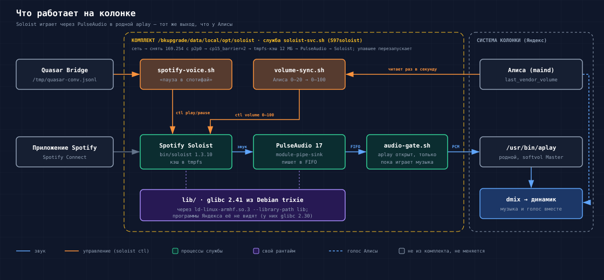
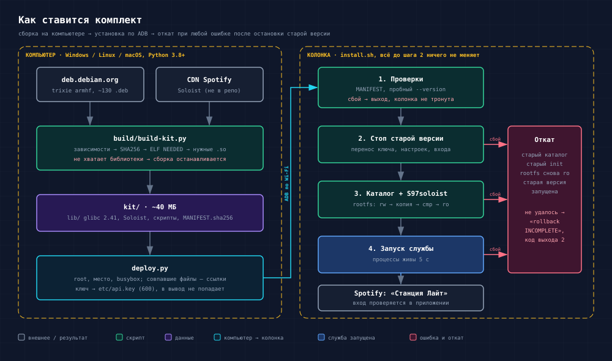

# Spotify Connect для Яндекс Станции Лайт

Установщик официального клиента [Spotify Soloist](https://developer.spotify.com/documentation/soloist)
для рутованной Яндекс Станции Лайт (`yandexmicro`). Колонка появляется в приложении Spotify как
устройство Connect и играет музыку, Алиса при этом говорит поверх неё. Громкость музыки следует
за громкостью Алисы, а с [Quasar Bridge](https://hackalice.me/recipes/llm/#quasar-bridge) работают
голосовые команды «пауза в спотифай», «следующий трек в спотифай».

*English: an installer of Spotify Soloist (official Spotify Connect client) for a rooted Yandex
Station Lite. It builds a private Debian trixie armhf runtime on your computer and installs it
over ADB with a checked, rolled-back-on-error install. The Soloist binary is not stored here.*



Почему Soloist, а не librespot: на проверенном аккаунте librespot получал ошибку
[audio key](https://hackalice.me/recipes/spotify/#audio-key), а Soloist играл. Будет ли так на
других аккаунтах — неизвестно.

**Проверено на:** Станция Лайт (Micro v1.2), прошивка `0.369.1.46.4778262442.20261013.297`,
Soloist 1.3.10, один аккаунт Premium, ноябрь 2026. Установщик проверен на этой колонке
обновлением ручной установки и перезагрузкой; установка на чистую колонку — только тестами,
см. [ограничения](#ограничения).

> [!WARNING]
> Это эксперимент. Служба меняет общесистемную настройку ядра (`cp15_barrier`), снимает адрес
> `169.254.x.x` с интерфейса `p2p0` и пишет init-скрипт в rootfs. Сборка Soloist перестаёт
> работать через 90 дней после даты сборки, её надо [обновлять](#обновление-soloist).
> Колонку при проблемах не сбрасывайте кнопкой: сначала [откат](#откат).

## Что понадобится

- root и ADB по сети — [инструкция в вики hackalice](https://hackalice.me/start/root/);
- компьютер с Python 3.8+ и `adb` (Windows, Linux или macOS; Docker не нужен);
- Spotify Premium и API-ключ Soloist: [developer.spotify.com/dashboard/soloist](https://developer.spotify.com/dashboard/soloist).
  Ключ привязан к аккаунту, которым создан; Spotify просит им не делиться;
- ~40 МБ свободно на `/bkupgrade` и до 12 МБ ОЗУ под кэш. При игре у нас оставалось
  ~57–70 МБ доступной памяти из 244 (с работающим Quasar Bridge).

## Установка



На Windows вместо `python3` пишите `py`.

1. **Соберите комплект на компьютере:**

   ```sh
   python3 build/build-kit.py --out kit
   ```

   Скрипт скачивает индекс Debian 13 (trixie, armhf), считает зависимости `libc6`, `libpulse0`
   и `pulseaudio`, скачивает около 130 пакетов (~52 МБ) со сверкой SHA256, отбирает по ELF
   `NEEDED` только нужные библиотеки и скачивает Soloist с CDN Spotify. Если какой-то
   библиотеки не хватает, сборка останавливается с ошибкой. Результат — каталог `kit/`
   (~40 МБ) с `MANIFEST.sha256` и `BUILD-INFO`.

   Для повторяемой сборки: `--snapshot 20261108T000000Z` (Debian на дату) и
   `--soloist-sha256 …` (при несовпадении — ошибка). Подпись индекса Debian проверяется с
   `--keyring /usr/share/keyrings/debian-archive-keyring.gpg` (нужен `gpgv`).

2. **Положите ключ в файл** на компьютере, например `soloist.key` (одна строка).

3. **Поставьте на колонку:**

   ```sh
   adb connect IP_КОЛОНКИ:5555
   python3 deploy.py --kit kit --serial IP_КОЛОНКИ:5555 --key soloist.key --dry-run
   python3 deploy.py --kit kit --serial IP_КОЛОНКИ:5555 --key soloist.key
   ```

   `--dry-run` показывает, что будет скопировано, ничего не меняя. Дальше `deploy.py`
   проверяет root, место и команды busybox, копирует комплект в
   `/bkupgrade/data/local/opt/soloist.new` (файлы, которые уже стоят, не копируются, а
   связываются жёсткой ссылкой), кладёт ключ в `etc/api.key` с правами `600` и запускает на
   колонке `install.sh`. Тот сверяет файлы с манифестом, пробно запускает Soloist и PulseAudio
   из нового каталога, останавливает старую версию, переносит ключ, настройки и вход в
   аккаунт, ставит `/etc/init.d/S97soloist` и запускает службу. При ошибке возвращаются
   старый каталог и init-скрипт, rootfs снова только для чтения; если откат не удался,
   `install.sh` пишет «rollback INCOMPLETE» и выходит с кодом 2.

4. В приложении Spotify выберите устройство «Станция Лайт». После включения колонки до
   входа в аккаунт у нас проходило от ~2 до 3–4 минут.

Настройки — `/bkupgrade/data/local/opt/soloist/etc/soloist.conf`, образец —
[`device/soloist.conf.example`](device/soloist.conf.example): имя устройства, интерфейсы,
размер кэша, связка громкости.

## Использование

- Служба: `/etc/init.d/S97soloist {start|stop|restart|status}`.
- Не запускать при следующей загрузке: `touch /bkupgrade/data/local/opt/soloist/disabled`
  (работающую службу это не останавливает).
- Логи в ОЗУ: `/tmp/soloist-run/{svc,soloist,gate,pulse,voice,volume}.log`, после 256 КБ —
  копия `.1`.

**Громкость.** Кнопки на колонке, «Алиса, громче / тише» и приложение Яндекса меняют и голос,
и музыку: шкала Алисы 0–20 переводится в 0–100 Soloist (15 → 75), Soloist стартует с текущей
громкостью Алисы. Регулятор в приложении Spotify работает до следующей смены громкости Алисы.
Выключить связку — `VOLUME_SYNC=0` в `soloist.conf`. Проверено на колонке 08.11.2026,
в том числе после перезагрузки.

**Голос через Quasar Bridge.** Фразы «Алиса, включи / пауза / следующий трек / предыдущий
трек в спотифай». Нужны правило маршрута `llm` для слова «спотиф» и журнал разговоров моста в
`/tmp/quasar-conv.jsonl`; настройка — в
[рецепте вики](https://github.com/Marker284/yandex-station-extended/pull/170). Журнал хранит
текст всего, что сказано Алисе, пока колонка включена.

## Ограничения

- Проверено на одной колонке и одном аккаунте. Установка без прежней версии проверена только
  тестами: на `/bkupgrade` проверенной колонки не хватило бы места на вторую копию.
- Первый вход после загрузки бывает неудачным ([spotify/soloist#18](https://github.com/spotify/soloist/issues/18)):
  служба замечает это и перезапускает Soloist.
- `cp15_barrier=2` действует на всю систему, пока работает служба; при остановке
  возвращается прежнее значение.
- Ключ передаётся Soloist через `-k`, поэтому виден в списке процессов колонки; из логов он
  вырезается.
- Выбрать голосом исполнителя или песню нельзя: в Soloist нет поиска.

## Обновление Soloist

Та же пара команд `build-kit.py` и `deploy.py`. Обычно меняется только `bin/soloist`
(~29 МБ), остальное связывается со старой установкой. Если на `/bkupgrade` не хватает места,
`deploy.py` остановится до каких-либо изменений и напишет, сколько нужно. На проверенной
колонке оставалось ~27 МБ — этого может не хватить; обновления на месте без отката пока нет.

## Откат

```sh
/etc/init.d/S97soloist stop &&
mount -o remount,rw / && rm -f /etc/init.d/S97soloist &&
mount -o remount,ro / && grep -q " / [^ ]* ro[, ]" /proc/mounts &&
rm -rf /bkupgrade/data/local/opt/soloist
```

Каждый шаг выполняется, только если удался предыдущий.

## Как это работает

- **Свой рантайм.** Soloist требует glibc 2.38, на колонке 2.30. Библиотеки Debian trixie
  лежат в `lib/` комплекта и подключаются только для своих программ через
  `lib/ld-linux-armhf.so.3 --library-path lib`; программы Яндекса их не видят.
- **Звук.** PulseAudio пишет в FIFO, а играет родной `aplay` колонки — тот же звуковой
  выход, что у Алисы. `audio-gate.sh` держит его открытым только пока играет музыка.
- **`cp15_barrier=2`.** С эмуляцией барьеров ядром Soloist зависал в цикле
  ([spotify/soloist#32](https://github.com/spotify/soloist/issues/32)).
- **IPv4 с `p2p0`.** С адресом `169.254.x.x` на `p2p0` телефон колонку не видел
  ([spotify/soloist#33](https://github.com/spotify/soloist/issues/33)).
- **Кэш в tmpfs 12 МБ**, чтобы не забить флеш, где лежат данные Яндекса.

Подробный разбор — в рецепте для вики [hackalice.me](https://hackalice.me/)
([PR](https://github.com/Marker284/yandex-station-extended/pull/170)).

## Файлы

| Файл | Где работает | Что делает |
|---|---|---|
| `build/build-kit.py` | компьютер | индекс Debian → зависимости → .deb со сверкой SHA256 → ELF-замыкание → `kit/` |
| `deploy.py` | компьютер | копирует `kit/` по ADB и запускает `install.sh` на колонке |
| `device/install.sh` | колонка | проверка, замена каталога, init-скрипт в rootfs, запуск, откат при ошибке |
| `device/soloist-svc.sh` | колонка | служба: сеть, `p2p0`, CP15, tmpfs-кэш, PulseAudio, Soloist, перезапуски |
| `device/audio-gate.sh` | колонка | держит системный `aplay` открытым только пока играет музыка |
| `device/spotify-voice.sh` | колонка | голосовые команды по журналу Quasar Bridge → `soloist ctl` |
| `device/volume-sync.sh` | колонка | громкость Soloist следует за громкостью Алисы |
| `device/lib.sh`, `soloist.conf.example` | колонка | общие функции и настройки |
| `device/S97soloist` | колонка | init-скрипт (путь подставляет `install.sh`) |

Бинарника Soloist здесь нет: `build-kit.py` скачивает его с CDN Spotify, а Spotify
[просит](https://developer.spotify.com/documentation/soloist/reference/downloads-and-updates)
не распространять его архивы.

## Тесты

```sh
python3 -m unittest discover -s build/tests     # сборщик, любая ОС
BB=/usr/bin/busybox sh tests/run.sh              # скрипты колонки: Linux, python3
python3 tests/mutants.py                         # то же с откатом каждого исправления
```

`tests/run.sh` гоняет скрипты колонки под busybox с заглушками `ip`, `mount`, `aplay`,
PulseAudio и Soloist, ничего в системе не меняя. Нужен busybox, который ищет команды по `PATH`
(динамический `busybox` из Debian или Ubuntu, не `busybox-static`). `tests/mutants.py` по
очереди откатывает исправления в копии `device/` и проверяет, что нужный тест краснеет.

## Лицензия

[MIT](LICENSE). Soloist, PulseAudio и библиотеки Debian, которые скачивает `build-kit.py`,
распространяются по своим лицензиям.
